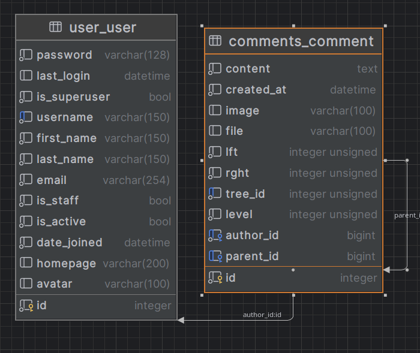

# Dzen Task

A Django REST Framework API and Vue frontend for threaded comments, user accounts, and comment attachments.

## Table of Contents
- [Overview](#overview)
- [Features](#features)
- [Architecture](#architecture)
- [Technology Stack](#technology-stack)
- [Project Structure](#project-structure)
- [Installation](#installation)
  - [Prerequisites](#prerequisites)
  - [Manual Setup](#manual-setup)
  - [Docker Setup](#docker-setup)
- [API Endpoints](#api-endpoints)
- [Usage Examples](#usage-examples)
- [Contributing](#contributing)
- [License](#license)
- [Acknowledgments](#acknowledgments)

## Overview
Dzen Task is a full-stack commenting platform built with Django REST Framework (backend) and Vue 3 (frontend). It allows users to register, create threaded comments, attach files, and receive real-time updates. The project emphasizes security, performance, and scalability.

The deployed project is accessible at [http://127.0.0.1:8080/](http://127.0.0.1:8080/) (on VPS via https://zomro.com/).

## Features
- **User Management**: Registration with CAPTCHA, JWT authentication, profile management (homepage, avatar)
- **Commenting System**: Hierarchical comments (using django-mptt), real-time updates via WebSocket, file attachments (images and text files with validation and resizing)
- **Security**: 
  - XSS protection (HTML sanitization allowing only `<a>`, `<code>`, `<i>`, `<strong>` tags)
  - SQL injection prevention (ORM usage)
  - CAPTCHA for registration
  - JWT authentication for protected endpoints
- **Performance**: 
  - Redis caching for comment trees and CAPTCHA answers
  - Redis as broker for Celery (background tasks) and Channels (WebSocket)
  - Celery for asynchronous tasks (email notifications)
  - Efficient database queries with MPTT
- **Real-time Updates**: WebSocket integration for live comment updates
- **Notifications**: Email notifications for comment replies (via Celery)
- **Documentation**: Auto-generated API schema (OpenAPI/Swagger)
- **Containerization**: Docker and Docker Compose for easy deployment

## Architecture
The project follows a modular Django architecture with separate apps for different concerns:

### Backend (Django)
- **RESTful API**: Django REST Framework ViewSets and APIViews
- **Data Modeling**:
  - Custom User model (extends AbstractUser) with homepage and avatar fields
  - Comment model with MPTT for efficient tree operations
  - File handling with automatic resizing and collision prevention
- **Authentication & Security**:
  - JWT token authentication (rest_framework_simplejwt)
  - CAPTCHA protection (simple math challenge)
  - File upload validation (extension, integrity, dimensions)
  - HTML sanitization (nh3 library)
- **Caching**: Redis for captcha answers and user serializer caching
- **Background Tasks**: Celery with Redis broker for email notifications
- **Real-time Communication**: Django Channels with WebSocket support
- **Environment Configuration**: python-dotenv for environment variables

### Frontend (Vue 3)
- **Framework**: Vue 3 with Vite build tool
- **Components**:
  - CommentList.vue: Displays threaded comments with sorting options
  - CommentForm.vue: Form for creating comments and replies
- **State Management**: Pinia (or Vuex, adjust if needed)
- **API Communication**: Axios for REST API, WebSocket for real-time updates
- **Styling**: CSS (with potential for SCSS/Tailwind)

### Infrastructure
- **Containerization**: Docker images for backend and frontend
- **Orchestration**: Docker Compose for multi-service deployment
- **Services**:
  - web-app: Django backend
  - redis: Caching and channels layer
  - celery: Background worker
  - frontend: Vue 3 development/production server

## Technology Stack
### Backend
- **Language**: Python 3.14
- **Framework**: Django 6.1.2
- **API**: Django REST Framework
- **Database**: PostgreSQL via Supabase (configured via DATABASE_URL)
- **ORM**: Django ORM
- **Authentication**: REST Framework Simple JWT
- **Caching**: Redis (used for comment trees, CAPTCHA, Celery broker, and Channels)
- **Background Tasks**: Celery (with Redis broker and Django DB result backend)
- **Real-time**: Django Channels (with Redis backend)
- **File Handling**: Custom upload handling with Pillow for image processing; storage on Supabase S3-compatible API
- **Validation**: HTML sanitization (nh3), file validation
- **Documentation**: DRF Spectacular (OpenAPI/Swagger)
- **Dependency Management**: UV

### Frontend
- **Language**: JavaScript (ES6+)
- **Framework**: Vue 3
- **Build Tool**: Vite
- **HTTP Client**: Axios
- **Real-time**: WebSocket API
- **Styling**: CSS
- **Dependency Management**: npm

### DevOps & Infrastructure
- **Containerization**: Docker
- **Orchestration**: Docker Compose
- **Version Control**: Git
- **CI/CD**: Placeholder for GitHub Actions (to be added)

## Project Structure
```
dzen-task/
├── backend/                  # Django application
│   ├── app/                  # Project configuration
│   │   ├── settings.py       # Django settings
│   │   ├── urls.py           # URL routing
│   │   ├── wsgi.py           # WSGI entrypoint
│   │   └── asgi.py           # ASGI entrypoint (for Channels)
│   ├── user/                 # User app (registration, profiles)
│   │   ├── models.py         # Custom User model
│   │   ├── serializers.py    # User serializers
│   │   └── views.py          # Registration and token views
│   ├── comments/             # Comments app (threaded commenting system)
│   │   ├── models.py         # Comment model (MPTT)
│   │   ├── serializers.py    # Nested serializers with caching
│   │   ├── views.py          # CommentViewSet with custom actions
│   │   ├── signals.py        # Signal handlers (e.g., for notifications)
│   │   └── task.py           # Celery tasks (email notifications)
│   ├── captcha/              # CAPTCHA app (math-based)
│   │   └── views.py          # CAPTCHA generation and validation
│   ├── notification/         # Notification app (email utilities)
│   │   └── email_notification.py
│   ├── media/                # User uploads (images, text files)
│   ├── utils.py              # Utility functions (UniqueFilePath, resize_image)
│   ├── validators.py         # File and image validation
│   ├── manage.py             # Django management script
│   ├── Dockerfile            # Backend Docker image
│   ├── entrypoint.sh         # Docker entrypoint (migrations, superuser, server)
│   ├── pyproject.toml        # UV dependencies
│   └── uv.lock               # UV lock file
├── frontend/                 # Vue 3 application
│   ├── src/
│   │   ├── components/       # Vue components (CommentList, CommentForm)
│   │   ├── api/              # API service layer
│   │   └── assets/           # Static assets
│   ├── Dockerfile            # Frontend Docker image
│   ├── package.json          # npm dependencies
│   └── vite.config.js        # Vite configuration
├── docker-compose.yml        # Multi-service orchestration
├── README.md                 # This file
├── CLAUDE.md                 # Architecture guide for Claude Code
├── task.pdf                  # Original assignment
└── db_schema.png             # Database schema diagram
```




## Video Presentation
- Start: https://www.loom.com/share/73bfb016e7ca42c89d8a964171663dfa
- End: https://www.loom.com/share/682a62def7fa410a9bffc9ebbdbef7cf

## Installation

### Prerequisites
- Git
- Python 3.14+ (with UV) or Docker & Docker Compose
- Node.js 18+ and npm (for frontend development without Docker)
- Redis server (for manual setup)

### Manual Setup
1. **Clone the repository**:
   ```bash
   git clone <repository-url>
   cd dzen-task
   ```

2. **Backend Setup**:
   ```bash
   cd backend
   # Install dependencies
   uv sync
   # Rename sample.env to .env and fill in the required environment variables
   cp backend/sample.env backend/.env
   ```
   Before running the server, ensure you have edited `backend/.env` to set the required environment variables. The `.env` file is copied from `sample.env` which contains comments for each variable. At a minimum, you should set:
   - `SECRET_KEY`: a strong secret key for Django cryptographic signing
   - `DATABASE_URL`: the full PostgreSQL connection string (or set the individual Supabase variables: `HOST`, `PORT`, `DATABASE`, `USER`, `DATABASE_PASSWORD`)
   - `REDIS_URL`: the Redis connection URL (e.g., `redis://localhost:6379/1` for local Redis, or `redis://redis:6379/1` when using Docker)
   - Email variables (`EMAIL_HOST`, `EMAIL_PORT`, `EMAIL_HOST_USER`, `EMAIL_HOST_PASSWORD`, `EMAIL_USE_TLS`, `EMAIL_USE_SSL`) if you want to enable email notifications
   - Storage variables (`ENDPOINT_URL`, `REGION`, `ACCESS_KEY`, `STORAGE_SECRET_KEY`, `BUCKET_NAME`) if you want to use S3-compatible storage (like Supabase)

   Then continue with the setup:
   ```bash
   # Apply migrations
   uv run python manage.py migrate
   # Create superuser (optional)
   uv run python manage.py createsuperuser
   # Start development server
   uv run python manage.py runserver
   ```
   The API will be available at `http://localhost:8000`.

3. **Frontend Setup** (optional, for development):
   ```bash
   cd ../frontend
   npm install
   npm run dev
   ```
   The frontend will be available at `http://localhost:5173` (or as configured) and will proxy API requests to `http://localhost:8000`.

### Docker Setup
1. **Build and start all services**:
   ```bash
   docker compose up --build
   ```
   This will start:
   - Backend API at `http://localhost:8000`
   - Frontend at `http://localhost:8080`
   - Redis at `localhost:6379`
   - Celery worker (running in background)

2. **Stop services**:
   ```bash
   docker compose down
   ```

3. **Rebuild after code changes**:
   ```bash
   docker compose up --build --no-deps <service-name>
   ```

## API Endpoints
The API is documented via OpenAPI/Swagger at `/api/schema/` (Swagger UI) and `/api/schema/redoc/` (Redoc).

### Key Endpoints
#### Authentication
- `POST /api/user/register/` - User registration (requires CAPTCHA)
- `POST /api/user/token/` - Obtain JWT token
- `POST /api/user/token/refresh/` - Refresh JWT token

#### User Management
- `GET /api/user/profile/` - Retrieve current user profile
- `PATCH /api/user/profile/` - Update current user profile

#### Comments
- `GET /api/comments/` - List top-level comments (paginated, 25 per page)
- `POST /api/comments/` - Create a new comment (authenticated)
- `GET /api/comments/{id}/` - Retrieve a specific comment
- `PATCH /api/comments/{id}/` - Update a comment (owner only)
- `DELETE /api/comments/{id}/` - Delete a comment (owner only)
- `GET /api/comments/tree/` - Get entire comment tree (for initial load)

#### CAPTCHA
- `GET /api/captcha/` - Generate a new CAPTCHA image and return key
- `POST /api/captcha/validate/` - Validate CAPTCHA response

### Query Parameters & Features
- **Pagination**: `limit` and `offset` (default limit: 25)
- **Ordering**: `ordering` parameter (fields: `user_name`, `user_email`, `created_at`; prefix `-` for descending)
- **Search**: Not implemented in current version (can be added)
- **File Attachments**: Include `image` or `file` in multipart/form-data when creating/updating comments

## Usage Examples
### Registering a New User
1. Obtain a CAPTCHA:
   ```http
   GET /api/captcha/
   ```
   Response: `{ "key": "captcha-key", "image": "base64-encoded-png" }`

2. Register with CAPTCHA solution:
   ```http
   POST /api/user/register/
   Content-Type: application/json

   {
     "username": "newuser",
     "email": "newuser@example.com",
     "homepage": "https://example.com",
     "password": "securepassword123",
     "captcha_key": "captcha-key",
     "captcha_value": "42"  // solution to the math problem
   }
   ```

### Creating a Comment
1. Obtain JWT token (after registration):
   ```http
   POST /api/user/token/
   Content-Type: application/json

   {
     "username": "newuser",
     "password": "securepassword123"
   }
   ```
   Response: `{ "access": "jwt-token", "refresh": "refresh-token" }`

2. Create a comment (with optional file attachment):
   ```http
   POST /api/comments/
   Authorization: Bearer jwt-token
   Content-Type: multipart/form-data

   {
     "user_name": "New User",
     "user_email": "newuser@example.com",
     "homepage": "https://example.com",
     "text": "This is a test comment!",
     "image": (optional image file),
     "file": (optional text file)
   }
   ```

### Retrieving Comment Tree
```http
GET /api/comments/tree/
Authorization: Bearer jwt-token
```
Returns a nested JSON structure of all comments with their replies.

## Contributing
1. Fork the repository
2. Create a feature branch (`git checkout -b feature/amazing-feature`)
3. Commit your changes (`git commit -m 'Add amazing feature'`)
4. Push to the branch (`git push origin feature/amazing-feature`)
5. Open a Pull Request

Please ensure your code follows the existing style and includes appropriate tests.

## License
This project is licensed under the MIT License - see the LICENSE file for details.

## Acknowledgments
- Django REST Framework for the powerful API toolkit
- Vue.js team for the progressive frontend framework
- The open-source community for packages like django-mptt, Redis, Celery, and nh3
- Contributors and reviewers who helped improve this project

---
*Note: This README was generated as part of the project documentation. For detailed architecture decisions, refer to CLAUDE.md.*